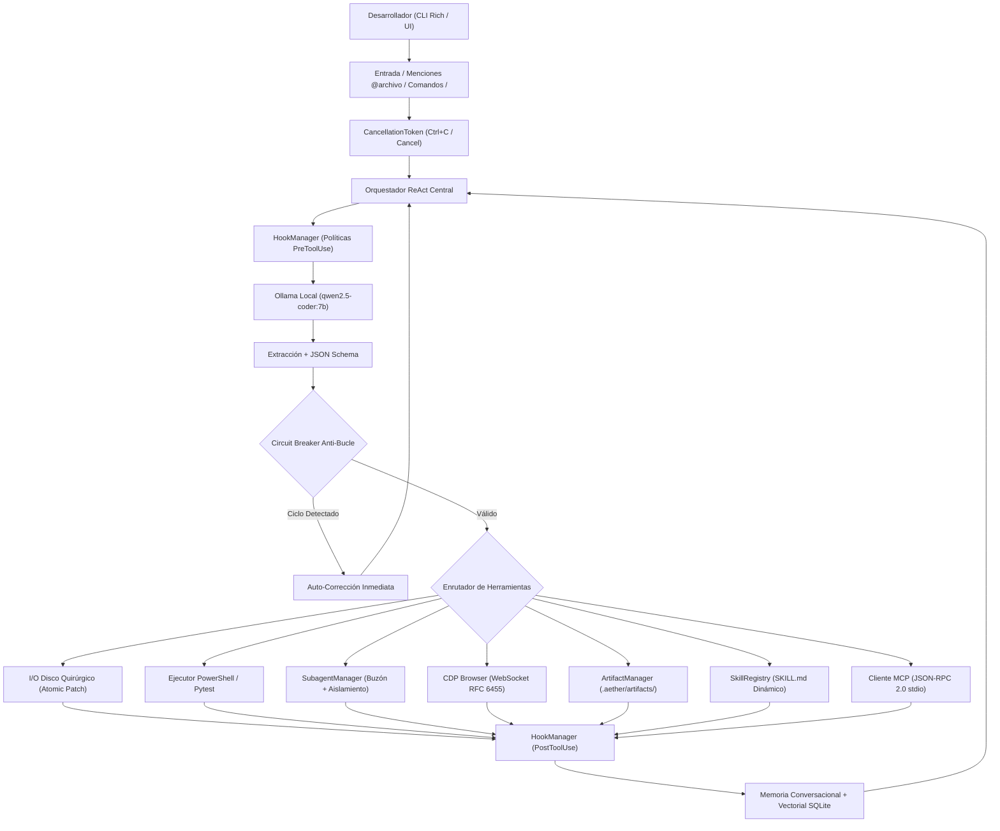

<div align="center">


# AETHER IDE

**Agente Autónomo de Ingeniería de Software Local, Bucle ReAct y CLI Interactiva**

[]()
[]()
[-success.svg)]()
[]()
[](https://github.com/cristianhar/aether-agent)
[]()
[-76b900.svg)]()
[]()

[English](./README.md) • [Guía de Arquitectura](./docs/architecture.md) • [Plan de Paridad 100% Antigravity](./docs/plan_paridad_100_antigravity.md) • [Arquitectura Tauri Desktop](./docs/desktop_tauri_architecture.md) • [Repositorio GitHub](https://github.com/cristianhar/aether-agent)

</div>

---

## ⚡ Descripción General

**AETHER IDE** es un agente autónomo de ingeniería de software de élite que opera **100% de forma local y offline** directamente en tu máquina sobre Ollama (`qwen2.5-coder:7b`). Diseñado con paridad funcional 1:1 frente a Google Antigravity y Claude Code, reúne la autonomía en terminal de un ingeniero de software proactivo, la edición quirúrgica y mapeo sintáctico de Cursor/Aider, y la privacidad absoluta de un entorno local con costo \$0 de suscripción o APIs.

A diferencia de los asistentes conversacionales pasivos, AETHER es un agente con acceso y control total de su entorno:
- **Explora y mapea** el código mediante AST y gráficos de dependencias.
- **Materializa código real** en disco mediante parches atómicos transaccionales (`write_file`, `edit_file`).
- **Navega e interactúa en la web** mediante Chrome DevTools Protocol nativo (CDP por WebSockets, **CERO descargas pesadas de Playwright**).
- **Delega y colabora** con subagentes jerárquicos con contextos de memoria de tokens aislados y buzones de mensajería reactiva.
- **Formula preguntas interactivas** (`ask_question`) ante ambigüedades técnicas antes de cometer errores de diseño.
- **Auto-repara el código** iterativamente cuando detecta fallos en tests de pytest o tracebacks de ejecución.

---

## 🎭 Los 4 Modos Operativos de AETHER

AETHER adapta sus políticas de seguridad, hooks de ejecución y catálogo de herramientas según el modo seleccionado (`/mode <modo>`):

| Modo | Comando | Propósito y Comportamiento | Herramientas Disponibles |
| :--- | :--- | :--- | :--- |
| **AGENT** | `/mode agent` | **Desarrollo Autónomo Total:** El agente diagnostica, crea archivos, escribe pruebas, las ejecuta y auto-repara bugs en un ciclo cerrado de 4 fases de Antigravity. | Acceso completo (I/O disco, subterminal, subagentes, CDP, MCP). |
| **ASK** | `/mode ask` | **Consultor de Solo Lectura:** Inspecciona código, explica arquitecturas, navega documentación y responde dudas técnicas **sin modificar jamás el disco**. | Solo herramientas pasivas (`read_file`, `get_repo_map`, `search_codebase`, `browser_get_content`). |
| **PLAN** | `/mode plan` | **Arquitecto de Software:** Diseña modelos de datos, flujos de sistema y descompone requerimientos antes de escribir código. Puede interrogar al usuario con `ask_question` y generar artefactos en disco. | Herramientas de análisis, diseño, `ask_question`, `create_artifact` y `update_plan`. |
| **REVIEW** | `/mode review` | **Auditoría Supervisada con Diffs:** Inspecciona diffs y estado Git. Cada cambio propuesto genera un **Unified Diff interactivo** en consola que requiere autorización humana previa. | Herramientas de lectura, auditoría y mutación interceptada con previsualización de diff. |

---

## 🌟 Superpoderes y Capacidades Clave (1:1 Antigravity)

### 1. Cancelación Limpia en Caliente (`Ctrl+C` y `/cancel`)
Se acabó forzar el cierre de la terminal cuando el modelo genera texto de más. Al presionar `Ctrl+C` o emitir `/cancel`, el token de cancelación interrumpe inmediatamente el bucle de Ollama y devuelve el agente a estado `IDLE` en menos de 0.1s, **preservando intacta la memoria y el historial para tu siguiente instrucción**.

### 2. Preguntas Interactivas al Usuario (`ask_question`)
Cuando un requerimiento presenta múltiples opciones (ej: base de datos relacional vs NoSQL), el agente formula una pregunta estructurada con opción recomendada. En la CLI interactiva aparece un menú seleccionable `[1]`, `[2]...` para responder sin ambigüedades.

### 3. Gestor de Artefactos Persistentes (`ArtifactManager`)
Almacena documentos de arquitectura, especificaciones técnicas y planes de proyecto en `.aether/artifacts/<session_id>/`. Separa el documento Markdown de los metadatos JSON (`.meta.json`) para control de versiones semánticas, retroalimentación requerida (`request_feedback`) y exposición visual (`user_facing`). Accesibles mediante `/artifacts` y API REST.

### 4. Sistema de Habilidades Dinámicas (Skills Runtime `SKILL.md`)
Permite extender las capacidades de AETHER mediante carpetas modulares con archivos `SKILL.md` y YAML Frontmatter en `.aether/skills/`, `.agent/skills/` y `~/.aether/skills/`:
- **Descubrimiento automático** al iniciar o recargar en caliente con `/skills reload`.
- **Habilidades nativas:** `code-review` (auditoría AST de calidad), `test-scaffold` (esqueletos automáticos de pytest) y `dependency-audit` (gráfico de dependencias).
- **Documentación inyectada automáticamente** en el System Prompt para que el modelo sepa cuándo invocar cada skill con `execute_skill(skill_name="...")`.

### 5. Subagentes Jerárquicos y Buzón de Mensajería Reactiva
Permite al agente principal delegar misiones especializadas a subagentes auxiliares:
- **Aislamiento total de tokens:** Cada subagente corre con su propia memoria acotada sin saturar la VRAM de la GPU.
- **Tipos de subagente:** `research` (investigador en solo lectura), `tester` (auditor de pruebas), `self` (desarrollador completo) o tipos dinámicos creados en caliente con `define_subagent`.
- **Buzón bidireccional:** El agente coordinador envía mensajes y recibe respuestas usando `send_message` conservando el hilo del subagente.
- **Sandboxes aislados:** Soporte para workspace `inherit` (mismo directorio) y `branch` (carpeta temporal aislada eliminada al terminar).

### 6. Navegación Web Ligera vía Chrome DevTools Protocol (CDP - CERO Playwright)
Olvídate de descargas pesadas de 400 MB de Chromium: AETHER se conecta mediante sockets nativos en Python (RFC 6455 WebSocket) a tu navegador Google Chrome o Microsoft Edge en el puerto 9222:
- Carga de SPAs y sitios dinámicos con renderizado completo de JavaScript (`browser_open`).
- Extracción de texto y selectores específicos (`browser_get_content`).
- Clics en botones y enlaces interactivos (`browser_click`).
- Relleno de formularios y campos de texto (`browser_type`).
- Capturas de pantalla visuales PNG en disco (`browser_screenshot`).

### 7. Circuit Breaker Anti-Bucle Matemático
Algoritmo en ventanas deslizantes que rastrea hashes SHA-256 de acciones recientes:
- Detecta ciclos de reintento ($p \in [1, 3]$) o comandos repetidos tras errores.
- Intercepta ediciones fallidas y obliga al modelo a leer el archivo en disco antes de volver a escribir.
- Garantiza que el agente no pueda dar por concluido un turno si las pruebas de validación fallaron.

### 8. Memoria Semántica a Largo Plazo (RAG Local SQLite)
Almacén vectorial SQLite con `nomic-embed-text` y fallback léxico BM25. Recuerda decisiones de arquitectura, convenciones y hechos técnicos a lo largo de semanas de trabajo (`/memory`).

### 9. Monitor de Hardware y VRAM en Tiempo Real
Monitorea en tiempo real la memoria GPU de 6 GB, capas cargadas en VRAM, offload a CPU y tasa de fallos de herramientas. Accesible mediante `/status`, `/telemetry` o la herramienta `get_hardware_vram_status`.

---

## 🏗️ Arquitectura del Sistema



---

## 🚀 Inicio Rápido

### 1. Requisitos Previos
- **Python:** 3.10, 3.11 o 3.12 instalado.
- **Ollama:** Instalado y ejecutándose (`ollama serve`).
- **Navegador (Opcional para CDP):** Google Chrome o Microsoft Edge.
- **Modelo recomendado:**
  ```bash
  ollama pull qwen2.5-coder:7b
  ```
  *(Opcional para embeddings semánticos: `ollama pull nomic-embed-text`)*

### 2. Instalación
```bash
git clone https://github.com/cristianhar/aether-agent.git
cd aether-agent

python -m venv .venv

# En Windows:
.\.venv\Scripts\activate

# En Linux/macOS:
source .venv/bin/activate

pip install -r requirements.txt
```

### 3. Lanzamiento
- **Windows (Lanzador con un clic):**
  ```cmd
  aether.bat
  ```
- **Lanzamiento directo por consola:**
  ```bash
  python main.py
  ```

---

## 🛠️ Catálogo Completo de Comandos Slash (`/`)

| Comando | Sintaxis / Opciones | Descripción |
| :--- | :--- | :--- |
| `/cancel` | `/cancel` o `/stop` | Cancela inmediatamente el turno activo sin cerrar la terminal, devolviendo el agente a `IDLE`. |
| `/mode` | `/mode [agent\|ask\|plan\|review]` | Alterna en caliente entre los 4 modos operativos especializados. |
| `/artifacts` | `/artifacts` o `/artifacts read <id>` | Explora el catálogo de especificaciones y planes persistentes o lee un artefacto completo. |
| `/skills` | `/skills`, `/skills reload`, `/skills info <n>` | Lista habilidades dinámicas, recarga carpetas `SKILL.md` o muestra instrucciones detalladas. |
| `/subagents`| `/subagents`, `/subagents status <id>`, `/subagents kill <id>` | Consulta el directorio de subagentes jerárquicos activos, sus buzones o los finaliza. |
| `/plan` | `/plan [objetivo]` | Diseña o visualiza el plan arquitectónico activo con casillas interactivas (`- [x]`). |
| `/memory` | `/memory`, `/memory search <término>` | Gestiona y busca hechos y decisiones en la memoria semántica SQLite a largo plazo. |
| `/compact` | `/compact` | Compacta el historial de conversación en un resumen ejecutivo liberando miles de tokens de VRAM. |
| `/telemetry`| `/telemetry` | Muestra métricas de latencia de Ollama, invocaciones y tasa de éxito de herramientas. |
| `/status` | `/status` | Muestra el estado del agente, consumo de VRAM de la GPU y estado de Git. |
| `/model` | `/model [nombre]` | Consulta o cambia el modelo de Ollama en caliente (ej: `/model deepseek-r1:7b`). |
| `/sessions` | `/sessions`, `/resume <id>` | Lista sesiones SQLite previas o reanuda una conversación anterior. |
| `/map` | `/map` | Muestra el mapa estructural del repositorio con firmas AST en ~300 tokens. |
| `/undo` | `/undo` | Revierte inmediatamente al último checkpoint seguro en 1 segundo. |
| `/checkpoint`| `/checkpoint [mensaje]` | Guarda un punto de restauración seguro con Git. |
| `/clear` | `/clear` | Limpia el contexto de conversación de la sesión activa para liberar memoria. |
| `/cd` | `/cd <ruta>` | Cambia el directorio de trabajo del agente y regenera el mapa del proyecto. |
| `/export` | `/export [archivo.md]` | Exporta la transcripción completa de razonamiento y código a Markdown. |
| `/exit` | `/exit` o `/quit` | Cierra la sesión de AETHER de forma segura. |

---

## 🧪 Pruebas y Control de Calidad

AETHER cuenta con una suite de pruebas automatizadas exhaustiva con **100% de tasa de aprobación**:

```bash
# Ejecutar la suite completa de pruebas unitarias (194 pruebas):
pytest -v

# Ejecutar el linter estricto de sintaxis (Flake8):
flake8 . --select=E9,F63,F7,F82 --exclude=.venv,venv

# Ejecutar la batería E2E real sobre Ollama (Cancelación, ask_question, Artifacts, Skills, Subagents, CDP):
python benchmarks/verify_e2e_features_real.py

# Ejecutar la batería de 16 escenarios integrales de 4 modos:
python benchmarks/run_full_e2e_battery.py
```

---

## 👤 Autor y Licencia

Desarrollado con pasión por **Cristian Arboleda** ([@cristianhar](https://github.com/cristianhar)).

Distribuido bajo la **Licencia MIT**. Siéntete libre de clonarlo, extenderlo y utilizarlo libremente.
