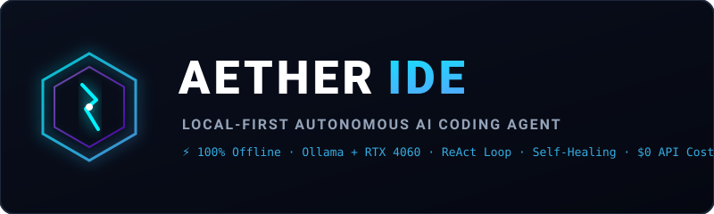
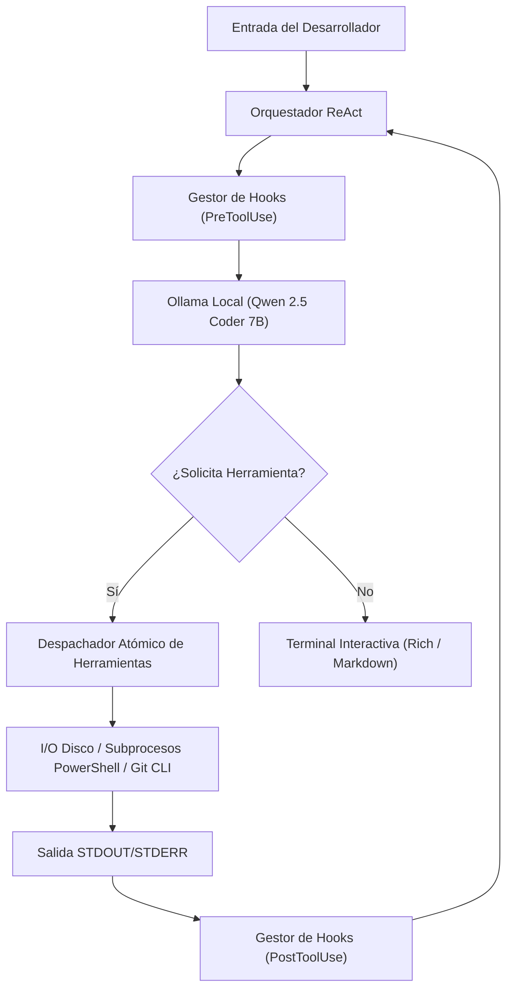

<div align="center">



# AETHER IDE

**Agente Autónomo de Ingeniería de Software Local y CLI Interactiva**

[]()
[]()
[](https://github.com/cristianhar/aether-agent)
[]()
[]()
[]()
[]()

[English](./README.md) • [Guía de Arquitectura](./docs/architecture.md) • [Plan de Paridad 100% Antigravity](./docs/plan_paridad_100_antigravity.md) • [Arquitectura Tauri Desktop](./docs/desktop_tauri_architecture.md) • [Repositorio GitHub](https://github.com/cristianhar/aether-agent)

</div>

---

## ⚡ Descripción General

**AETHER IDE** es un agente autónomo de programación que opera **100% de forma local y offline** sobre tu tarjeta gráfica utilizando Ollama (`qwen2.5-coder:7b`). Reúne la autonomía en terminal de Google Antigravity y Claude Code, la edición quirúrgica y mapeo sintáctico de Cursor/Aider, y la privacidad y velocidad de un entorno local sin costo de suscripción.

A diferencia de los chats pasivos, AETHER opera como un ingeniero de software activo: inspecciona la estructura del repositorio, crea archivos reales en disco, ejecuta pruebas en sub-terminales, captura errores de ejecución y auto-repara el código de forma iterativa en un bucle cerrado.

---

## 🌟 Superpoderes y Capacidades Clave (100% Paridad Antigravity)

| Capacidad | Implementación Técnica | Beneficio Práctico |
| :--- | :--- | :--- |
| **Bucle ReAct Autónomo** | Esquemas JSON Schema con streaming en `/api/chat` de Ollama | El agente selecciona herramientas, las ejecuta, observa la salida en consola y toma decisiones continuas. |
| **Subagentes Especializados Antigravity** | `delegate_research` (solo lectura AST) y `delegate_test` (auditoría de pruebas) | Delega tareas de investigación o diagnóstico en contextos de memoria aislados. |
| **Modo Planificación y Artefactos (`/plan`)** | Artefactos Markdown en `.aether/plans/plan_activo.md` con casillas interactivas (`- [x]`) | Visibilidad en tiempo real de hitos, progreso secuencial y criterios de aceptación. |
| **Memoria Semántica Persistente (RAG Local)** | Almacén vectorial SQLite con `nomic-embed-text` y fallback léxico | Recuerda decisiones arquitectónicas, reglas del usuario y convenciones entre sesiones (`/memory`). |
| **Despacho Concurrente Asíncrono** | `ThreadPoolExecutor` para ejecución paralela de herramientas pasivas | Reduce drásticamente la latencia en lecturas simultáneas de archivos, outlines y repo-maps. |
| **Circuit Breaker Matemático** | Detección periódica en ventanas deslizantes ($p \in [1, 3]$) y tracking SHA-256 | Corta bucles infinitos de reintento entre herramientas cuando una acción falla reiteradamente. |
| **Compactación de Contexto (`/compact`)** | Resumen ejecutivo sintético de turnos pasados de herramientas | Mantiene el hilo de razonamiento liberando miles de tokens de VRAM en sesiones largas. |
| **Motor Transaccional de Parches** | Escritura atómica (`.tmp` + `os.replace`), SHA-256 pre-check y reversión | Cero riesgo de corrupción de archivos, ediciones truncadas o colisiones de concurrencia. |
| **Motor de Permisos y Jaula** | Aislamiento en límites de workspace, patrones destructivos y confirmación | Impide destrucción accidental o modificaciones fuera del proyecto. |
| **Checkpoints Seguros por Archivo** | Snapshots de pre-imagen en `.aether/checkpoints/<id>/` | Restaura quirúrgicamente solo los archivos del agente sin `git reset --hard` destructivo. |
| **Persistencia SQLite de Sesiones** | Base de datos `.aether/sessions.db` con `/sessions` y `/resume` | Reanuda tareas y audita ejecuciones entre reinicios sin perder contexto. |
| **Repo-Map Compacto** | Extracción sintáctica AST de clases, firmas y métodos | Mapea proyectos enteros en ~300 tokens sin saturar la memoria de contexto. |
| **Diagnósticos Estáticos AST** | Validación de sintaxis para Python y JSON (`get_diagnostics`) | Comprueba la validez sintáctica del código antes y después de aplicar cambios. |
| **Model Context Protocol (MCP)** | Cliente stdio JSON-RPC 2.0 con `tools/list` y `tools/call` | Conecta servidores MCP externos configurados en `.aether/mcp_servers.json`. |

---

## 🏗️ Diagrama de Arquitectura



---

## 🚀 Inicio Rápido

### 1. Requisitos Previos
- **Python:** 3.10, 3.11 o 3.12 instalado.
- **Ollama:** Instalado y corriendo (`ollama serve`).
- **Modelo recomendado:**
  ```bash
  ollama pull qwen2.5-coder:7b
  ```

### 2. Instalación
Clona el repositorio y configura el entorno:
```bash
git clone https://github.com/cristianhar/aether-ide.git
cd aether-ide
python -m venv .venv

# Windows:
.\.venv\Scripts\activate
# Linux/macOS:
source .venv/bin/activate

pip install -r requirements.txt
```

### 3. Ejecución
- **Windows (Lanzador con un clic):**
  ```cmd
  aether.bat
  ```
- **Lanzamiento directo por consola:**
  ```bash
  python main.py
  ```

---

## 🛠️ Comandos Slash (`/`)

| Comando | Descripción |
| :--- | :--- |
| `/cd <ruta>` | Cambia el directorio de trabajo activo y genera el nuevo Repo-Map. |
| `/plan [objetivo]` | Diseña y visualiza artefactos de planes arquitectónicos (`.aether/plans/plan_activo.md`) con casillas interactivas. |
| `/memory [search <término>]` | Consulta o busca hechos persistentes y decisiones arquitectónicas en la memoria semántica SQLite. |
| `/compact` | Compacta el historial de conversación en un resumen ejecutivo liberando miles de tokens en VRAM. |
| `/mode [agent\|ask\|plan]` | Cambia entre modo autónomo, modo de solo lectura (preguntas) o planificación. |
| `/map` | Muestra la arquitectura completa del repositorio (clases, métodos, firmas). |
| `/test [ruta]` | Ejecuta pruebas con `pytest` y ofrece auto-sanación instantánea si algo falla. |
| `/diff` | Muestra los cambios actuales pendientes con resaltado de sintaxis. |
| `/commit [mensaje]` | Prepara todos los cambios (`git add -A`) y realiza un commit limpio bajo control explícito del desarrollador. |
| `/export [archivo.md]` | Exporta la transcripción de la sesión y el código a un informe Markdown. |
| `/undo` | Revierte al último checkpoint seguro en 1 segundo. |
| `/checkpoint [msg]` | Guarda un punto de restauración seguro con Git. |
| `/model <nombre>` | Cambia el modelo de Ollama en caliente (ej: `/model qwen2.5-coder:7b`). |
| `/status` | Muestra el modelo activo, telemetría de tokens en VRAM y estado de Git. |
| `/clear` | Limpia la memoria de contexto para liberar VRAM. |
| `/exit` | Cierra la sesión de AETHER de forma segura. |

---

## 🧪 Pruebas Automatizadas

El proyecto incluye 111 pruebas automatizadas exhaustivas que validan la edición quirúrgica, auto-linter, hooks, memoria semántica, circuit breaker, bucle ReAct y subagentes:

```bash
pytest -v
```

---

## 👤 Autor

Desarrollado por **Cristian Arboleda** ([@cristianhar](https://github.com/cristianhar))

Distribuido bajo la **Licencia MIT**.
