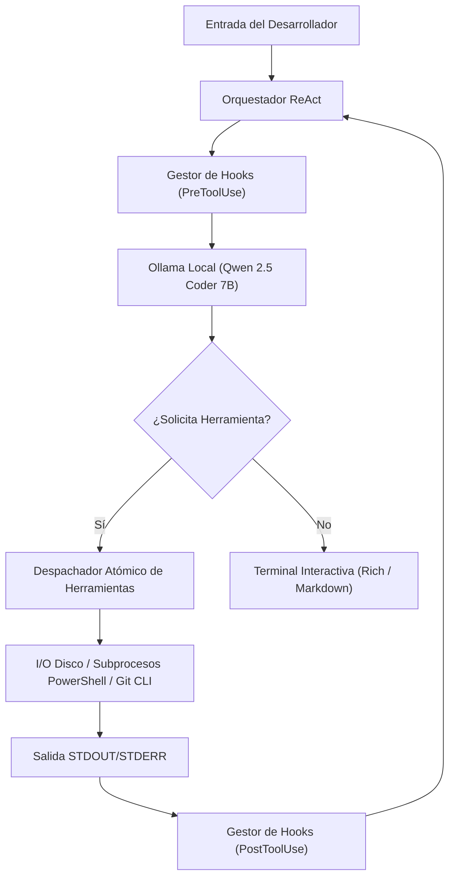

<div align="center">


# AETHER IDE

**Agente Autónomo de Ingeniería de Software Local y CLI Interactiva**

[]()
[]()
[]()
[]()
[]()

[English](./README.md) • [Guía de Arquitectura](./docs/architecture.md) • [Plan Maestro](./docs/plan_maestro.md)

</div>

---

## ⚡ Descripción General

**AETHER IDE** es un agente autónomo de programación que opera **100% de forma local y offline** sobre tu tarjeta gráfica utilizando Ollama (`qwen2.5-coder:7b`). Reúne la autonomía en terminal de Claude Code, la edición quirúrgica y mapeo sintáctico de Cursor/Aider, y la privacidad y velocidad de un entorno local sin costo de suscripción.

A diferencia de los chats pasivos, AETHER opera como un ingeniero de software activo: inspecciona la estructura del repositorio, crea archivos reales en disco, ejecuta pruebas en sub-terminales, captura errores de ejecución y auto-repara el código de forma iterativa en un bucle cerrado.

---

## 🌟 Superpoderes y Capacidades Clave

| Capacidad | Implementación Técnica | Beneficio Práctico |
| :--- | :--- | :--- |
| **Bucle ReAct Autónomo** | Esquemas JSON Schema con streaming en `/api/chat` de Ollama | El agente selecciona herramientas, las ejecuta, observa la salida en consola y toma decisiones continuas. |
| **Motor de Auto-Sanación (Self-Healing)** | Captura de tracebacks y sugerencias guiadas de recuperación | Si una prueba o script falla (ej. `EOFError`, `SyntaxError`), AETHER crea parches o mocks y vuelve a probar hasta dejarlas en verde (`exit code 0`). |
| **Repo-Map Compacto** | Extracción sintáctica AST de clases, firmas y métodos | Mapea proyectos enteros en ~300 tokens sin saturar la memoria de contexto. |
| **Edición Quirúrgica con Fuzzy Match** | Tolerancia inteligente a sangrías y validación de sintaxis | Modifica bloques de código sin romper indentaciones ni sobreescribir archivos enteros. |
| **Modos de Trabajo** | Sistema de hooks con soporte para `/mode ask`, `/mode agent`, `/mode plan` | Modo de solo lectura en `ask`; creación y ejecución con plenos poderes en `agent`. |
| **Subagentes Lógicos** | Contextos de conversación aislados compartiendo el modelo local | Delega investigaciones pesadas o auditorías a subagentes auxiliares sin ensuciar la memoria principal. |
| **Checkpoints de Seguridad Git** | Snapshots inmediatos con Git y rollback instantáneo (`/undo`) | Revierte cualquier cambio defectuoso en menos de 1 segundo. |
| **Navegación Dinámica** | Comando `/cd <ruta>` con re-indexación automática | Salta entre diferentes proyectos de tu PC sin mover el lanzador. |

---

## 🏗️ Diagrama de Arquitectura



---

## 🚀 Inicio Rápido

### 1. Requisitos Previos
- **Python:** 3.10, 3.11 o 3.12 instalado.
- **Ollama:** Instalado y corriendo (`ollama serve`).
- **Modelo recomendado:**
  ```bash
  ollama pull qwen2.5-coder:7b
  ```

### 2. Instalación
Clona el repositorio y configura el entorno:
```bash
git clone https://github.com/cristianhar/aether-ide.git
cd aether-ide
python -m venv .venv

# Windows:
.\.venv\Scripts\activate
# Linux/macOS:
source .venv/bin/activate

pip install -r requirements.txt
```

### 3. Ejecución
- **Windows (Lanzador con un clic):**
  ```cmd
  aether.bat
  ```
- **Lanzamiento directo por consola:**
  ```bash
  python main.py
  ```

---

## 🛠️ Comandos Slash (`/`)

| Comando | Descripción |
| :--- | :--- |
| `/cd <ruta>` | Cambia el directorio de trabajo activo y genera el nuevo Repo-Map. |
| `/mode [agent\|ask\|plan]` | Cambia entre modo autónomo, modo de solo lectura (preguntas) o planificación. |
| `/map` | Muestra la arquitectura completa del repositorio (clases, métodos, firmas). |
| `/test [ruta]` | Ejecuta pruebas con `pytest` y ofrece auto-sanación instantánea si algo falla. |
| `/diff` | Muestra los cambios actuales pendientes con resaltado de sintaxis. |
| `/commit [mensaje]` | Prepara todos los cambios (`git add -A`) y realiza un commit limpio. |
| `/export [archivo.md]` | Exporta la transcripción de la sesión y el código a un informe Markdown. |
| `/undo` | Revierte al último checkpoint seguro en 1 segundo. |
| `/model <nombre>` | Cambia el modelo de Ollama en caliente (ej: `/model qwen2.5-coder:7b`). |
| `/status` | Muestra el modelo activo, telemetría de tokens en VRAM y estado de Git. |
| `/clear` | Limpia la memoria de contexto para liberar VRAM. |
| `/exit` | Cierra la sesión de AETHER de forma segura. |

---

## 🧪 Pruebas Automatizadas

El proyecto incluye 24 pruebas automatizadas que validan la edición quirúrgica, linter, hooks, bucle ReAct y subagentes:

```bash
pytest -v
```

---

## 👤 Autor

Desarrollado por **Cristian Arboleda** ([@cristianhar](https://github.com/cristianhar))

Distribuido bajo la **Licencia MIT**.
