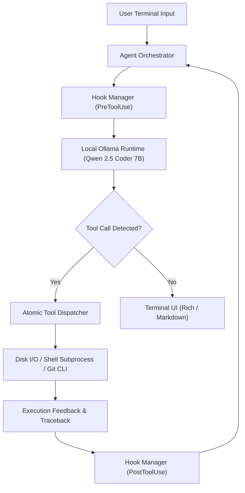

<div align="center">


# AETHER IDE

**Local-First Autonomous AI Software Engineering Agent & Interactive CLI**

[]()
[]()
[]()
[]()
[]()

[Español](./README.es.md) • [Architecture Guide](./docs/architecture.md) • [Master Plan](./docs/plan_maestro.md)

</div>

---

## ⚡ Overview

**AETHER IDE** is an autonomous AI coding assistant running **100% offline and locally** on your GPU via Ollama (`qwen2.5-coder:7b`). It brings together the terminal-first autonomy of Claude Code, the surgical code editing and AST repo-mapping of Cursor/Aider, and the zero-latency responsiveness of an offline development environment.

Unlike simple chat interfaces, AETHER operates as an active software engineer: it reads your project structure, inspects abstract syntax trees, writes physical files to disk, executes unit tests in subshells, detects runtime tracebacks, and automatically self-heals failing code in closed feedback loops.

---

## 🌟 Key Features & Superpowers

| Capability | Technical Implementation | Practical Benefit |
| :--- | :--- | :--- |
| **Autonomous ReAct Loop** | Pydantic JSON schemas with Ollama `/api/chat` streaming | The agent decides tools, runs them, observes terminal outputs, and iterates automatically. |
| **Self-Healing Feedback Engine** | Traceback capture and auto-guided recovery prompts | When a unit test or script throws an exception (e.g. `EOFError`, `SyntaxError`), AETHER writes patches or test mocks and re-executes until passing green (`exit code 0`). |
| **Compact Repo-Map** | AST symbol extraction for classes, signatures, and functions | Maps multi-file repositories in ~300 tokens without overflowing context windows. |
| **Surgical Editing & Fuzzy Matching** | Indentation-tolerant matching with AST validation | Edits target code blocks without breaking indentation or overwriting whole files. |
| **Operational Modes** | Hook system supporting `/mode ask`, `/mode agent`, `/mode plan` | Read-only inspection in `ask` mode; full file creation and execution in `agent` mode. |
| **Claude-Code Style Subagents** | Isolated conversation contexts sharing the local model | Offload heavy research or log audits to auxiliary subagents without polluting primary memory. |
| **Git Safety Checkpoints** | Instant snapshot commits and rollback (`undo_checkpoint`) | Safely revert code modifications in less than 1 second. |
| **Dynamic Project Navigation** | `/cd <path>` with automatic project re-indexing | Jump between repositories seamlessly on your computer. |

---

## 🏗️ Architecture



---

## 🚀 Quick Start

### 1. Prerequisites
- **Python:** 3.10, 3.11, or 3.12 installed.
- **Ollama:** Installed and running locally (`ollama serve`).
- **Recommended Model:**
  ```bash
  ollama pull qwen2.5-coder:7b
  ```

### 2. Installation
Clone the repository and install dependencies:
```bash
git clone https://github.com/cristianhar/aether-ide.git
cd aether-ide
python -m venv .venv

# Windows:
.\.venv\Scripts\activate
# Linux/macOS:
source .venv/bin/activate

pip install -r requirements.txt
```

### 3. Launching AETHER
- **Windows (Single click launcher):**
  ```cmd
  aether.bat
  ```
- **CLI Direct Launch:**
  ```bash
  python main.py
  ```

---

## 🛠️ Slash Commands Reference

| Slash Command | Description |
| :--- | :--- |
| `/cd <path>` | Switch active workspace directory and generate a fresh Repo-Map. |
| `/mode [agent\|ask\|plan]` | Switch between autonomous agent mode, read-only inspection, and architectural planning. |
| `/map` | Display complete repository structure with class outlines and function signatures. |
| `/test [target]` | Run test suites (`pytest`) and trigger automatic self-repair if tests fail. |
| `/diff` | Display colorized syntax-highlighted git diff of pending uncommitted changes. |
| `/commit [message]` | Stage all changes and generate a clean git commit. |
| `/export [file.md]` | Export the active session reasoning transcript and generated code into Markdown. |
| `/undo` | Roll back to the last safe checkpoint snapshot in 1 second. |
| `/model <name>` | Switch local models on-the-fly (e.g. `/model qwen2.5-coder:7b` or `/model deepseek-r1:7b`). |
| `/status` | View active model, VRAM token telemetry, and Git working tree status. |
| `/clear` | Reset context memory to release GPU VRAM. |
| `/exit` | Exit the CLI session safely. |

---

## 🧪 Testing

AETHER comes with a full automated test suite verifying file editing, syntax linting, repo-mapping, shell execution, and hook policies:

```bash
pytest -v
```

---

## 🐳 Docker Deployment (Optional)

Run containerized with connection to host Ollama:
```bash
docker compose up -d
```

---

## 👤 Author

Developed by **Cristian Arboleda** ([@cristianhar](https://github.com/cristianhar))

Distributed under the **MIT License**.
