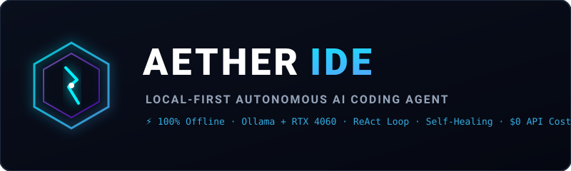
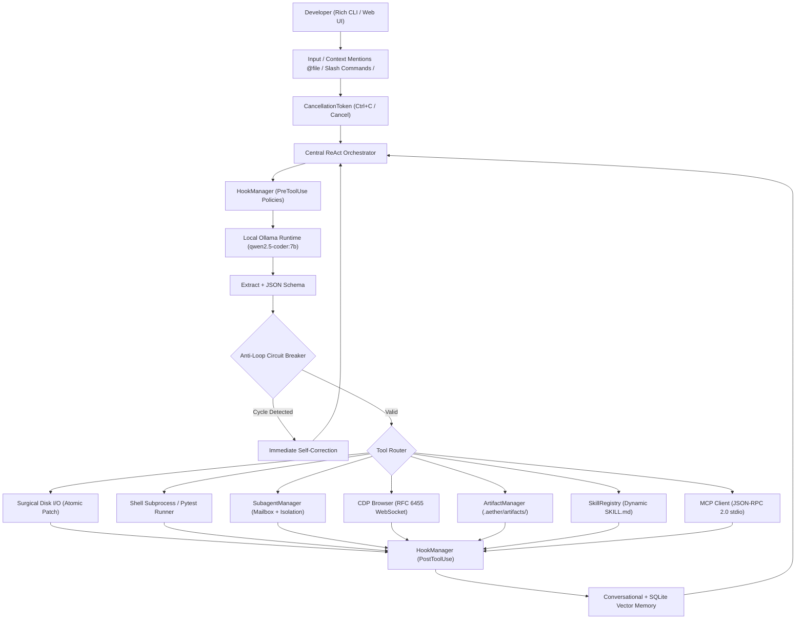

<div align="center">



# AETHER IDE

**Local-First Autonomous AI Software Engineering Agent, ReAct Runtime & Interactive CLI**

[]()
[]()
[-success.svg)]()
[]()
[](https://github.com/cristianhar/aether-agent)
[]()
[-76b900.svg)]()
[]()

[Español](./README.es.md) • [Architecture Guide](./docs/architecture.md) • [Parity Plan 100% Antigravity](./docs/plan_paridad_100_antigravity.md) • [Tauri Desktop Architecture](./docs/desktop_tauri_architecture.md) • [GitHub Repository](https://github.com/cristianhar/aether-agent)

</div>

---

## ⚡ Overview

**AETHER IDE** is an elite autonomous software engineering agent that runs **100% locally and offline** directly on your GPU using Ollama (`qwen2.5-coder:7b`). Architected for 1:1 functional parity with Google Antigravity and Claude Code, it combines the terminal-first autonomy of a proactive software engineer, the surgical code editing and AST repo-mapping of Cursor/Aider, and the absolute privacy of an offline development environment with zero subscription or API fees.

Unlike passive chat assistants, AETHER operates as an active software engineer with full control over its workspace:
- **Explores and maps** multi-file codebases using AST symbol extraction and dependency graphs.
- **Writes production-grade code** to disk using atomic transactional patch engines (`write_file`, `edit_file`).
- **Navigates and interacts with the web** using native Chrome DevTools Protocol (CDP over WebSockets, **ZERO heavy Playwright binaries**).
- **Delegates and collaborates** with hierarchical subagents running in isolated token memory contexts with reactive mailboxes.
- **Asks interactive questions** (`ask_question`) when technical ambiguities arise to prevent flawed design assumptions.
- **Self-heals failing code** automatically across closed iterative loops when pytest tests fail or tracebacks occur.

---

## 🎭 The 4 Operating Modes

AETHER dynamically adapts its security policies, execution hooks, and tool availability according to the active mode (`/mode <mode>`):

| Mode | Command | Purpose & Behavior | Available Tools |
| :--- | :--- | :--- | :--- |
| **AGENT** | `/mode agent` | **Full Autonomous Development:** The agent diagnoses, creates files, writes unit tests, executes test suites, and self-heals code following Antigravity's 4-phase cycle. | Full access (disk I/O, subshells, subagents, CDP browser, MCP). |
| **ASK** | `/mode ask` | **Read-Only Consultant:** Inspects codebases, explains architectural designs, browses documentation, and answers technical questions **without modifying disk**. | Passive inspection tools only (`read_file`, `get_repo_map`, `search_codebase`, `browser_get_content`). |
| **PLAN** | `/mode plan` | **Software Architect:** Designs data models, outlines system workflows, and breaks down requirements before touching code. Can interrogate the user via `ask_question` and persist plan artifacts. | Analytical tools, data modeling, `ask_question`, `create_artifact`, and `update_plan`. |
| **REVIEW** | `/mode review` | **Supervised Code Review with Diffs:** Audits pending diffs and git working trees. Every proposed change renders a colorized **Unified Diff in console** requiring explicit human approval. | Read-only inspection, auditing, and intercepted file modification tools. |

---

## 🌟 Key Superpowers & Capabilities (1:1 Antigravity Parity)

### 1. Graceful Hot Cancellation (`Ctrl+C` & `/cancel`)
No more terminating terminal sessions when an LLM over-generates tokens. Pressing `Ctrl+C` or typing `/cancel` immediately cancels the active turn, returning AETHER to `AETHER ❯ [IDLE]` in under 0.1s while **keeping conversation memory and session state intact for your next instruction**.

### 2. Interactive User Questions (`ask_question`)
When a technical requirement offers multiple design avenues (e.g. relational PostgreSQL vs document NoSQL), the agent calls `ask_question`. The rich terminal renders an interactive keyboard-navigable menu `[1]`, `[2]...` with recommended options, eliminating guesswork.

### 3. Persistent Artifact Engine (`ArtifactManager`)
Saves system architecture designs, data models, and specifications to `.aether/artifacts/<session_id>/`. Decouples Markdown document bodies from `.meta.json` metadata (version tracking, `request_feedback`, and `user_facing` flags). Inspectable via `/artifacts` and built-in REST endpoints.

### 4. Dynamic Skills Runtime (`SKILL.md` with YAML Frontmatter)
Extend AETHER's capabilities on the fly by creating modular folders containing `SKILL.md` files with YAML Frontmatter in `.aether/skills/`, `.agent/skills/`, or `~/.aether/skills/`:
- **Automatic discovery** at launch or re-scanned in real time via `/skills reload`.
- **Pre-installed native skills:** `code-review` (AST code complexity audit), `test-scaffold` (automated pytest generation), and `dependency-audit` (module coupling map).
- **Dynamic prompt catalog:** Injects registered skills into the system prompt so the model autonomously invokes `execute_skill(skill_name="...")`.

### 5. Hierarchical Subagents & Reactive Mailbox Messaging
Enables the primary agent to delegate specialized missions to auxiliary subagents:
- **Token isolation:** Subagents run with independent, bounded memory contexts without exhausting the host GPU's VRAM window.
- **Subagent archetypes:** `research` (read-only code explorer), `tester` (test suite auditor), `self` (general developer), or custom templates registered via `define_subagent`.
- **Bi-directional mailbox:** The coordinator exchanges messages with active subagents via `send_message`, maintaining subagent conversation continuity.
- **Isolated workspaces:** Supports `inherit` mode (shared root) and `branch` mode (isolated ephemeral sandbox directories cleaned up on termination).

### 6. Lightweight Web Automation via Chrome DevTools Protocol (CDP - ZERO Playwright)
Say goodbye to 400 MB Playwright/Chromium downloads. AETHER communicates directly with your existing Google Chrome or Microsoft Edge browser via pure Python RFC 6455 WebSockets on port 9222:
- Renders dynamic client-side JavaScript and SPAs (`browser_open`).
- Extracts clean DOM text and specific CSS selectors (`browser_get_content`).
- Interacts with buttons and navigation links (`browser_click`).
- Types input into form fields and textareas (`browser_type`).
- Captures full-resolution visual PNG screenshots (`browser_screenshot`).

### 7. Mathematical Anti-Loop Circuit Breaker
Sliding-window algorithm tracking SHA-256 action hashes:
- Detects retry cycles ($p \in [1, 3]$) or identical commands repeating across failure loops.
- Intercepts failed edits and enforces reading physical disk lines before re-attempting changes.
- Guarantees an agent cannot close an active plan while verification test suites are failing.

### 8. Persistent Long-Term Semantic Memory (Local SQLite RAG)
Vector store running locally on SQLite powered by `nomic-embed-text` with lexical BM25 fallback. Persists architecture decisions, conventions, and facts across days of development (`/memory`).

### 9. Real-Time Hardware & VRAM Telemetry
Live telemetry monitoring GPU memory consumption (optimized for 6 GB RTX 4060 GPUs), Ollama model layers, CPU offloading, and tool failure rates. Inspectable via `/status`, `/telemetry`, or `get_hardware_vram_status`.

---

## 🏗️ System Architecture



---

## 🚀 Quick Start

### 1. Prerequisites
- **Python:** 3.10, 3.11, or 3.12 installed.
- **Ollama:** Installed and running locally (`ollama serve`).
- **Browser (Optional for CDP):** Google Chrome or Microsoft Edge.
- **Recommended Model:**
  ```bash
  ollama pull qwen2.5-coder:7b
  ```
  *(Optional for semantic memory: `ollama pull nomic-embed-text`)*

### 2. Installation
```bash
git clone https://github.com/cristianhar/aether-agent.git
cd aether-agent

python -m venv .venv

# On Windows:
.\.venv\Scripts\activate

# On Linux/macOS:
source .venv/bin/activate

pip install -r requirements.txt
```

### 3. Launching AETHER
- **Windows (Single click launcher):**
  ```cmd
  aether.bat
  ```
- **CLI Direct Launch:**
  ```bash
  python main.py
  ```

---

## 🛠️ Complete Slash Commands Reference (`/`)

| Slash Command | Syntax / Options | Description |
| :--- | :--- | :--- |
| `/cancel` | `/cancel` or `/stop` | Immediately cancel the active turn without closing the terminal, resetting agent to `IDLE`. |
| `/mode` | `/mode [agent\|ask\|plan\|review]` | Switch between the 4 specialized operational modes on the fly. |
| `/artifacts` | `/artifacts` or `/artifacts read <id>` | Explore the catalog of persistent specifications and architectural plans, or read a document. |
| `/skills` | `/skills`, `/skills reload`, `/skills info <n>` | List dynamic skills, reload `SKILL.md` folders from disk, or view execution directives. |
| `/subagents`| `/subagents`, `/subagents status <id>`, `/subagents kill <id>` | Inspect active hierarchical subagents, review their mailbox exchanges, or terminate workers. |
| `/plan` | `/plan [goal]` | Design or view the active architectural plan with interactive checkable task items (`- [x]`). |
| `/memory` | `/memory`, `/memory search <query>` | Manage and query technical facts and decisions in long-term SQLite semantic memory. |
| `/compact` | `/compact` | Compress conversation history into an executive summary, freeing GPU VRAM tokens. |
| `/telemetry`| `/telemetry` | View latency benchmarks, tool invocation breakdowns, and tool success rate metrics. |
| `/status` | `/status` | Display active agent state, GPU VRAM token consumption, and Git working tree status. |
| `/model` | `/model [name]` | Inspect or change Ollama models on the fly (e.g. `/model deepseek-r1:7b`). |
| `/sessions` | `/sessions`, `/resume <id>` | List past SQLite sessions or resume a previous conversation. |
| `/map` | `/map` | Render the repository structural map with AST signatures in ~300 tokens. |
| `/undo` | `/undo` | Roll back to the last safe checkpoint snapshot in 1 second. |
| `/checkpoint`| `/checkpoint [message]` | Save a safe restoration checkpoint with Git. |
| `/clear` | `/clear` | Reset context memory to release GPU VRAM. |
| `/cd` | `/cd <path>` | Switch active workspace directory and generate a fresh Repo-Map. |
| `/export` | `/export [file.md]` | Export the active session reasoning transcript and generated code into Markdown. |
| `/exit` | `/exit` or `/quit` | Safely terminate the CLI session. |

---

## 🧪 Testing & Quality Gate

AETHER is backed by a rigorous test suite maintaining a **100% pass rate**:

```bash
# Run complete unit test suite (194 tests passing):
pytest -v

# Run strict syntax linter (Flake8 Quality Gate):
flake8 . --select=E9,F63,F7,F82 --exclude=.venv,venv

# Run real local LLM E2E battery (Hot Cancel, ask_question, Artifacts, Skills, Subagents, CDP):
python benchmarks/verify_e2e_features_real.py

# Run comprehensive 16-scenario battery evaluating all 4 operational modes:
python benchmarks/run_full_e2e_battery.py
```

---

## 👤 Author & License

Developed with passion by **Cristian Arboleda** ([@cristianhar](https://github.com/cristianhar)).

Distributed under the **MIT License**. Feel free to fork, expand, and build upon it!
