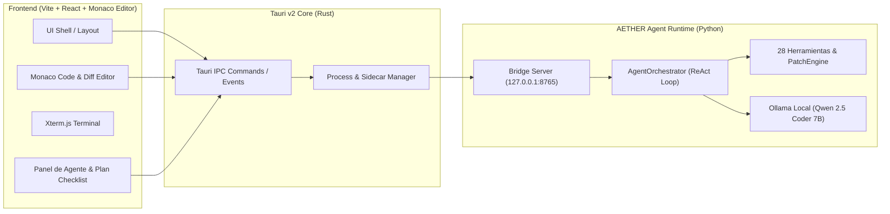

# 🖥️ Arquitectura de Escritorio AETHER IDE: Tauri v2 + Monaco Editor

> **Diseño Arquitectónico de la Interfaz Gráfica Nativa de Alto Rendimiento para AETHER.**  
> Optimizado para la GPU **NVIDIA GeForce RTX 4060 Laptop (6 GB VRAM)** y 16 GB RAM en Windows 11.

---

## 1. ¿Por qué Tauri v2 y no Electron?

Para un entorno de desarrollo con IA local donde Ollama consume entre 4.5 GB y 5.5 GB de VRAM y memoria compartida, el consumo de RAM de la aplicación de escritorio es crítico:

| Métrica | Electron (VS Code / Cursor) | Tauri v2 (AETHER IDE Desktop) | Ventaja AETHER |
| :--- | :---: | :---: | :--- |
| **Consumo de RAM en Reposo** | ~400 – 650 MB (Chromium + Node) | **~35 – 55 MB** (WebView2 Nativo) | **~10x más ligero** (Deja 500 MB libres para Ollama) |
| **Tiempo de Inicio (Cold Boot)** | ~2.5 – 4.0 segundos | **~0.3 – 0.5 segundos** | Inicio instantáneo |
| **Tamaño del Instalador / Binario** | ~150 – 220 MB | **~12 – 18 MB** | Portabilidad y despliegue rápido |
| **Seguridad de Procesos** | Permisos amplios de Node.js | **Modelo de Capacidades de Rust** | Control nativo alineado con el `PermissionEngine` |

---

## 2. Diagrama de Comunicación y Flujo de Datos



---

## 3. Disposición de la Interfaz (UI Wireframe)

```
┌────┬──────────────────────┬────────────────────────────────────┬──────────────────────┐
│ A  │ EXPLORADOR / TREE    │ MONACO CODE EDITOR / DIFF VIEWER   │ AETHER AGENT CHAT    │
│ C  ├──────────────────────┼────────────────────────────────────┼──────────────────────┤
│ T  │ 📁 routers/          │ def calculate_tax(amount):         │ 🧠 Pensamiento:      │
│ I  │   └── orders.py      │ -   return amount * 0.10           │ Analizando el bug... │
│ V  │ 📁 services/         │ +   return amount * 0.19           │                      │
│ I  │   └── payment.py     │                                    │ 📋 Plan:             │
│ T  │ 📁 tests/            │ [Guardar] [Revertir] [Diagnóstico] │ 1. ✅ Mapear repo    │
│ Y  │                      │                                    │ 2. ⏳ Aplicar parche │
│    │                      │                                    │ 3. ⬜ Correr tests   │
│ B  ├──────────────────────┴────────────────────────────────────┤                      │
│ A  │ TERMINAL INTEGRADA (Xterm.js) / DIAGNÓSTICOS AST          │ [Pregunta o Tarea...]│
│ R  │ PS C:\project> pytest -v                                  │ [Enviar] [Cancelar]  │
└────┴───────────────────────────────────────────────────────────┴──────────────────────┘
```

---

## 4. Endpoints del Puente Local (`bridge/server.py`)

El servidor puente local expone endpoints HTTP/JSON-RPC de alta velocidad con cero dependencias externas:

- `GET /api/status`: Retorna estado del agente, modelo, sesión activa e información de VRAM.
- `GET /api/tree`: Retorna el árbol y Repo-Map del proyecto.
- `GET /api/file?path=...`: Carga el contenido de un archivo en el editor Monaco.
- `POST /api/file`: Guarda un archivo de forma atómica.
- `GET /api/diff`: Retorna las diferencias de Git para el Monaco Diff Viewer.
- `POST /api/chat`: Envía tareas al agente y retorna respuesta, pensamiento y herramientas ejecutadas.
- `POST /api/cancel`: Aborta inmediatamente la generación o tarea en curso.
- `GET /api/sessions`: Lista el historial de sesiones guardadas en SQLite.

---

## 5. Próximos Pasos de Scaffolding

1. Inicializar la plantilla Tauri v2 con:
   ```powershell
   npm create tauri-app@latest aether-desktop -- --template react-ts
   ```
2. Instalar `@monaco-editor/react`, `@xterm/xterm`, `lucide-react`, `tailwindcss`.
3. Conectar el cliente de Tauri con el servidor puente `bridge/server.py`.
