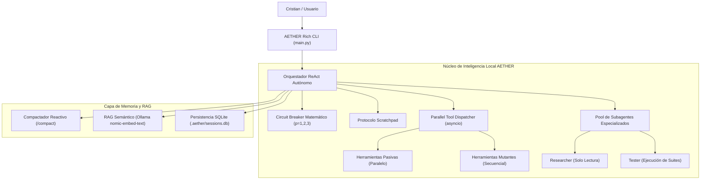

# Plan de Implementación: AETHER 1:1 Paridad Total con Antigravity

> **Autor:** Cristian Arboleda (`@cristianhar`)  
> **Arquitectura:** Local-First Agentic Developer · RTX 4060 (6 GB VRAM) · 100% Offline  
> **Objetivo:** Alcanzar el 100% de paridad funcional con Antigravity en arnés, concurrencia, subagentes especializados, planificación y memoria sin incurrir en costos de suscripción.

---

## 1. Análisis de Brecha Actual (Gap Analysis)

| Dimensión | Nivel Actual en AETHER | Nivel Objetivo Antigravity | Brecha Técnica a Resolver |
| :--- | :---: | :---: | :--- |
| **Ejecución de Herramientas** | 90% (Secuencial) | 100% (Paralelo Asíncrono) | Ejecutar llamadas de inspección pasiva en paralelo (`asyncio.gather`) en un solo turno. |
| **Arquitectura de Subagentes** | 60% (Genérico `delegate_task`) | 100% (Especializados Aislados) | Implementar subagentes nativos (`researcher` de solo lectura y `tester`) con contextos limpios. |
| **Planificación y Artefactos** | 75% (`/mode plan` básico) | 100% (Artefactos Estructurados) | Generación y persistencia de planes de arquitectura Markdown interactivos (`.aether/plans/`). |
| **Memoria a Largo Plazo** | 80% (SQLite + `/compact`) | 100% (Híbrida AST + RAG Local) | Indexación semántica local ultraligera vía Ollama (`nomic-embed-text`, ~250MB VRAM). |
| **Pruebas de UI Web** | 0% (Sin browser) | Documentado (Fase Futura) | Documentar integración futura de Playwright headless para `localhost:PORT`. |

---

## 2. Fase 1: Ejecución Asíncrona Concurrente de Herramientas (`asyncio.gather`)

### Diagnóstico del Problema:
Actualmente, si el modelo genera 3 llamadas de herramienta en el mismo turno (ejemplo: `read_file("a.py")`, `read_file("b.py")`, `search_codebase("symbol")`), AETHER las ejecuta una tras otra en un bucle `for tc in tool_calls:`.

### Solución Arquitectónica:
Separar las llamadas generadas en dos grupos mediante su `PermissionLevel`:
1. **Herramientas Pasivas / Idempotentes (`READ_ONLY`):**
   * `read_file`, `list_directory`, `search_codebase`, `get_file_outline`, `get_repo_map`, `find_definition`, `find_references`.
   * Se agrupan y se despachan concurrentemente usando `asyncio.gather()`. La latencia total del turno se reduce al tiempo de la herramienta más lenta.
2. **Herramientas de Mutación (`WORKSPACE_WRITE`, `COMMAND_EXECUTE`):**
   * `write_file`, `edit_file`, `run_command`, `create_checkpoint`.
   * Se ejecutan estrictamente en serie para preservar la integridad transaccional y el orden causal de las modificaciones en disco.

---

## 3. Fase 2: Subagentes Especializados Nativos (`researcher` y `tester`)

### Diagnóstico del Problema:
`delegate_task` actual crea un clon completo del orquestador. Si el agente principal quiere investigar una biblioteca grande o explorar 20 archivos, los resultados contaminan el contexto o corren el riesgo de modificar archivos accidentalmente.

### Solución Arquitectónica:
Crear dos tipos de subagentes especializados con permisos estricta y físicamente acotados:

1. **`researcher` (Investigador de Solo Lectura):**
   * **Herramientas permitidas:** `read_file`, `search_codebase`, `list_directory`, `get_file_outline`, `get_repo_map`, `find_definition`, `find_references`, `search_web`, `fetch_web_page`.
   * **Herramientas bloqueadas:** `write_file`, `edit_file`, `run_command`, `delete_file`.
   * **Objetivo:** Explorar código o documentación web y devolver un resumen ejecutivo sintetizado en <100 tokens al orquestador principal.
2. **`tester` (Auditor de Calidad y Pruebas):**
   * **Herramientas permitidas:** `run_tests`, `run_command` (restringido a pytest/unittest), `read_file`.
   * **Objetivo:** Ejecutar la suite completa de pruebas, analizar trazas de error y devolver un informe estructurado de fallos sin tocar código de producción.

---

## 4. Fase 3: Sistema de Artefactos y Modo Planificación (`/plan`)

### Diagnóstico del Problema:
En tareas complejas (refactorizaciones multi-módulo), los modelos pequeños tienden a perder el foco si empiezan a editar código sin una hoja de ruta visible.

### Solución Arquitectónica:
Implementar un sistema nativo de **Artefactos Markdown** en `.aether/artifacts/`:
1. **Comando `/plan`:**
   * Cambia el modo a planificación.
   * Obliga al modelo a crear un archivo Markdown `.aether/plans/plan_tarea.md` que contenga:
     * Objetivos claros con casillas de verificación (`- [ ]`).
     * Módulos afectados y dependencias.
     * Casos de prueba previstos.
2. **Ejecución Guiada:**
   * En modo ejecución, cada vez que AETHER concluye un hito, actualiza la casilla `- [x]` con `edit_file`, dándole al usuario visibilidad total en tiempo real de su progreso.

---

## 5. Fase 4: Memoria Semántica y RAG Local con Ollama (`nomic-embed-text`)

### Diagnóstico del Problema:
Cuando un proyecto tiene decenas de módulos o cuando Cristian inicia una nueva sesión mañana, el agente no recuerda soluciones previas ni la ubicación conceptual de funciones sin escanear el disco de nuevo.

### Solución Arquitectónica:
1. **Modelo de Embeddings Local:**
   * Utilizar `nomic-embed-text` a través de la API local de Ollama (`http://127.0.0.1:11434/api/embeddings`).
   * Tamaño en VRAM: solo **~274 MB**, dejando más de 5.7 GB libres para `qwen2.5-coder:7b`.
2. **Almacén Vectorial Ligero en SQLite:**
   * Integrar una tabla de vectores en `.aether/sessions.db` con campos `(symbol_name, file_path, docstring_or_snippet, embedding)`.
   * Permite realizar búsquedas semánticas del tipo: *"¿dónde manejamos la autenticación de usuarios?"* encontrando el archivo exacto en milisegundos sin quemar tokens del contexto principal.

---

## 6. Fase 5 (Documentada a Futuro): Driver de Navegador Web con Playwright

> [!NOTE]
> Esta fase queda formalmente documentada y especificada para su activación futura cuando Cristian decida desarrollar interfaces web interactivas completas.

### Especificación de Implementación Futura:
* **Dependencia:** `playwright` (Python headless Chromium).
* **Herramientas a exponer:**
  * `browser_navigate(url)`: Abre una pestaña en `localhost:PORT` o web externa.
  * `browser_click(selector)`: Interactúa con botones, enlaces o inputs.
  * `browser_snapshot()`: Captura el árbol DOM simplificado y textos visibles para verificación de UI.
  * `browser_screenshot(path)`: Guarda capturas de pantalla para inspección visual.

---

## 7. Plan de Ejecución por Etapas y Verificación

| Etapa | Tarea Técnica | Archivos Afectados | Criterio de Aprobación |
| :---: | :--- | :--- | :--- |
| **Etapa 1** | Despacho concurrente de herramientas pasivas con `asyncio` | `agent/orchestrator.py`, `tools/registry.py` | Pruebas de lectura múltiple simultánea pasando con latencia reducida. |
| **Etapa 2** | Subagentes especializados `researcher` y `tester` | `tools/subagent.py`, `agent/prompts.py`, `agent/orchestrator.py` | Test donde `researcher` audita código sin permisos de escritura. |
| **Etapa 3** | Modo Planificación y Artefactos `.aether/plans/` | `agent/orchestrator.py`, `main.py`, `agent/prompts.py` | Comando `/plan` genera artefacto estructurado antes de editar. |
| **Etapa 4** | Memoria Semántica Vectorial con `nomic-embed-text` | `agent/memory.py`, `tools/code_intel.py`, `.aether/sessions.db` | Búsqueda conceptual de símbolos devolviendo archivos precisos. |

---

## 8. Quality Gates Innegociables
1. **0 deuda técnica y 0 hardcoding de frameworks.**
2. **100% de pruebas unitarias pasando** en cada etapa (`pytest tests/`).
3. **0 errores de Flake8** (`E9, F63, F7, F82`).
4. **100% compatible con hardware RTX 4060 (6 GB VRAM) y ejecución offline.**
